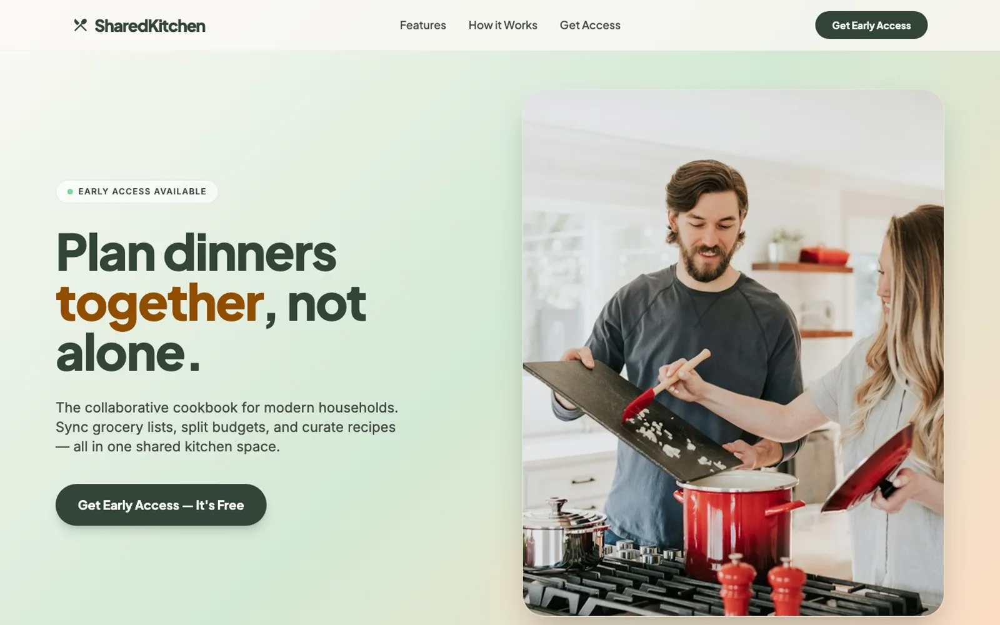
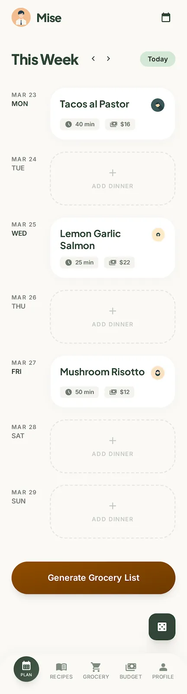
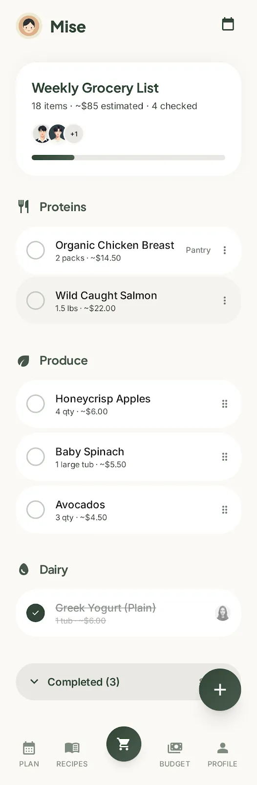
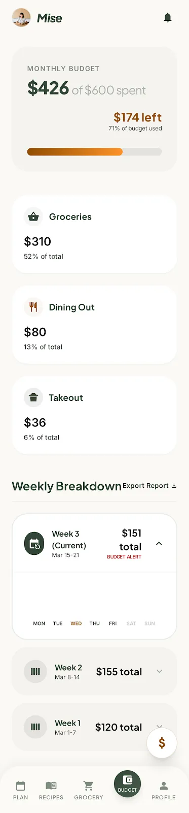
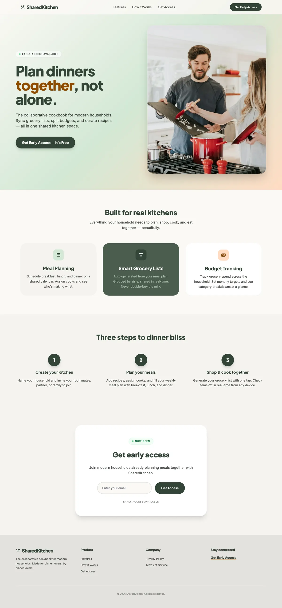

<div align="center">

# SharedKitchen

A collaborative cookbook for households. Plan meals together, sync grocery lists, split budgets, and share recipes.



</div>

---

## Features

- **Shared meal plan**: a household calendar of meals, with who is cooking each night
- **Synced grocery list**: generated from the meal plan, grouped by aisle, synced in real time
- **Budget tracking**: monthly grocery targets with category breakdowns
- **Household invites**: bring in roommates, a partner, or family
- **Premium**: Stripe subscription

<p align="center">
  
  
  
</p>

## Stack

| Layer | Tech |
|---|---|
| App | Expo 55, React Native, expo-router, Zustand |
| Data & auth | Supabase |
| Billing | Stripe |
| Landing page | Static HTML + Tailwind (`index.html`) |

## Running it

```bash
cp .env.example .env   # fill in your own keys
npm install
npx expo start
```

## Status

SharedKitchen was built in 2026 and is no longer live. The code is published here as a portfolio project. Read the case study at [diegofill.com/projects/sharedkitchen](https://diegofill.com/projects/sharedkitchen).

<details>
<summary>Full landing page</summary>



</details>

---

Built by [Diego Fill](https://diegofill.com).
